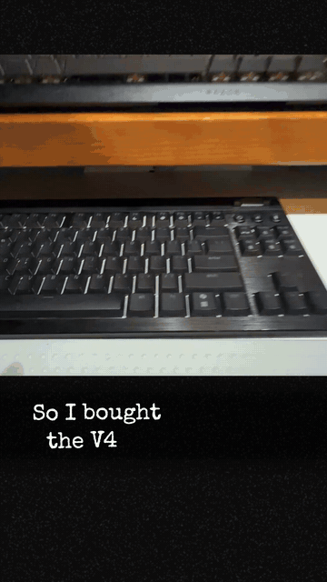

# agent-reel

**Video editing for coding agents: the agent decides, deterministic code renders, and a delivery gate decides whether it shipped.**
`agent-reel` (the command is `reel`) is an ffmpeg-based CLI plus a Claude Code skill and two hooks. The agent looks at footage and writes a JSON plan; code does the camera geometry, rendering and verification.
A video only counts as delivered when `reel deliver` has re-checked the file, copied it, verified the SHA-256 and written a receipt — so "done" is a file you can verify, not a sentence in a chat.

[中文说明](#中文)

## Showcase

Four videos that went through reel's gate. The previews are short excerpts; click one for the MP4 excerpt. In all four the picture was rendered by the project's own tooling — what reel did is stated per clip.

<table><tr>
<td width="25%"><a href="https://github.com/shuaige121/agent-reel/releases/download/v0.1.0/razer-mv.mp4"></a></td>
<td width="25%"><a href="https://github.com/shuaige121/agent-reel/releases/download/v0.1.0/boonlay.mp4"></a></td>
<td width="25%"><a href="https://github.com/shuaige121/agent-reel/releases/download/v0.1.0/maple-talking-head.mp4"></a></td>
<td width="25%"><a href="https://github.com/shuaige121/agent-reel/releases/download/v0.1.0/weimeng-001.mp4"></a></td>
</tr></table>

| Clip | What you see | What reel did here |
|---|---|---|
| **Lyric video** | Typed device labels follow a keyboard through handheld footage while the lyrics run below. | Lyric timing import, the music-video contract check, `check`, and `deliver` with a hash-bound receipt (final; reviewed by an agent). Rendered by the project's own Canvas script, not by reel. |
| **Boon Lay theme MV** | A year slider, flags and period photos animated from code on a map, driven by the lyrics. Live site: [boonlay.leonardchow.work](https://boonlay.leonardchow.work) | `check` and `deliver` with a receipt — delivered as a sample pending review, not as final. Rendering and lyric alignment are the project's own scripts. |
| **Maple Education talking-head series** | One episode of a Chinese-language talking-head series: burned-in subtitles, bullet cards, stickers and a calendar cutaway. | Brief, `check`, and `deliver` with a hash-bound receipt (final; reviewed by an agent). Built in a separate editor from a project template, not by reel. |
| **AI-generated music video** | Brush-script lyrics light up word by word as the line is sung. | The music-video contract check, `check`, and `deliver` with a receipt (no reviewer is recorded on it). Generated footage and compositing are project scripts. |

Notices:

- reel's receipts list what was not machine-checked (on-screen text, caption legibility and others). "Passed the gate" means the listed checks passed, not that the whole video was verified.
- **Lyric video**: an unofficial fan/parody work, not affiliated with or endorsed by Razer. Razer and product names are trademarks of their owner. The vocals are AI-generated.
- **Boon Lay theme MV**: map data © OpenStreetMap contributors. Photos in this excerpt, via Wikimedia Commons: Australian News and Information Bureau (public domain, 1965); A.K. Bristow (CC BY-SA 4.0); radios by Joe Haupt (CC BY 2.0, CC BY-SA 2.0). The vocals are AI-generated.
- **AI-generated music video**: the visuals and vocals in this excerpt are AI-generated.

## Why it exists

Agents are good at editorial decisions and bad at being their own QA. Three things go wrong in practice: the agent hand-writes fragile ffmpeg filter strings, it reports success on a file nobody verified, and it copies the wrong version into the delivery folder. `reel` splits the job:

| Who | Does what |
|---|---|
| Agent (LLM) | Looks at assets and gridded frames, picks targets, writes `plan.json` (assets, timings, typed camera ops — no filters, no shell) |
| `reel` engine | Validates the plan, computes framing, renders, then verifies the output file itself |
| Delivery gate | Technical checks + review records + brief → final, sample, or blocked; writes a hash-bound receipt |
| Claude Code hooks | Keep hand-rolled `cp`/`ffmpeg` out of the delivery folder; stop a "finished" reply that has no final receipt |

Every subcommand prints exactly one JSON object to stdout and exits non-zero with a structured error code on failure, so an agent can branch on results instead of parsing prose.

## Install

Requirements: macOS, Python 3.9 or newer, `ffmpeg`/`ffprobe` on `PATH`, and the Python packages Pillow and NumPy.

```bash
git clone https://github.com/shuaige121/agent-reel ~/.claude/plugins/reel
python3 -m venv ~/.local/share/reel/venv
~/.local/share/reel/venv/bin/python -m pip install pillow numpy
export PATH="$HOME/.claude/plugins/reel/bin:$PATH"     # put this line in ~/.zshrc
reel doctor
```

`bin/reel` is a small launcher script (works through a symlink). It picks the Python interpreter in this order: `REEL_PYTHON` if set, then `~/.local/share/reel/venv/bin/python`, then `python3` on `PATH`. Because it is a script on `PATH` and not a shell function, it also works in an agent's Bash tool, where every call starts a fresh shell.

`reel doctor` prints one JSON object that lists every required and optional dependency with a ready-to-run fix for each one that is missing. It exits 1 if a required item is missing (`DEPENDENCY_MISSING`); a missing optional item is only reported.

Optional features need extra tools; each one reports a structured error if its dependency is missing:

| Feature | Needs |
|---|---|
| Burned-in subtitles | ffmpeg built with libass, or `mpv` |
| Web-page shots (`kind: "web"`) | Playwright for Python |
| `reel words` | `whisper-cli` and a model file (`REEL_WHISPER_MODEL`) |
| `reel voice check` | the same `whisper-cli` and model; for Chinese (the default `--lang zh`) also `pypinyin`, installed into the same venv: `~/.local/share/reel/venv/bin/python -m pip install pypinyin` |
| `reel beats` / `reel snap` | a venv with librosa and beat_this; by default the same `~/.local/share/reel/venv`, or set `REEL_VENV_PY` |
| `reel locate` (find a target by text) | torch + transformers (OWLv2), local or on the remote GPU box |

## Quickstart

One still image, one voice track, one push-in, then the gate. Run it in an empty folder, with `reel` on `PATH` (see Install).

```bash
mkdir -p ~/reel-demo/assets ~/reel-demo/preview ~/reel-demo-out && cd ~/reel-demo

# 1. Test assets: a 1600x1200 image and a spoken voice track
ffmpeg -f lavfi -i "testsrc2=size=1600x1200" -frames:v 1 assets/a.png
say -o assets/voice.wav --data-format=LEI16@48000 \
  "This is a short voice track for the reel quickstart. The camera pushes in while I talk."

# 2. Look, then register what you saw
reel inspect assets/a.png assets/voice.wav
reel frame assets/a.png --out preview/a_grid.png     # open it: the frame with a 0-1 coordinate grid
reel observe --obs observations.json --src assets --asset a.png \
  --bbox 0.55,0.30,0.85,0.60 --label "target"         # returns id obs-1
```

Write `plan.json`. The camera op points at the observation, not at raw pixels:

```json
{"version": "reel.plan.v1", "src_dir": "assets",
 "output": {"width": 1080, "height": 1920, "fps": 30},
 "duration_policy": "fit_last_shot",
 "shots": [{"id": "s1", "asset": "a.png", "duration": 6,
   "camera": [{"op": "zoom_to", "observation_id": "obs-1", "t0": 0.5, "t1": 4.0, "easing": "ease_in_out"}]}],
 "audio": {"voice": "voice.wav"}}
```

```bash
# 3. Validate, compile, render (render verifies its own output)
reel validate plan.json
reel compile plan.json                                # frame-level timeline, nothing rendered
reel render plan.json --out demo.mp4 --where mac --sheet preview/final.png
```

Write `brief.json` — what is being delivered, and where:

```json
{"version": "reel.brief.v1", "name": "demo", "language": "en", "deliverable": "sample",
 "delivery_root": "~/reel-demo-out", "must_not_change": [],
 "voice": {"mode": "recorded"}, "profile": "default"}
```

```bash
# 4. The gate
reel check demo.mp4 --plan plan.json --brief brief.json --report check.json
reel deliver demo.mp4 --brief brief.json --version v1 --plan plan.json --sample
reel receipt .reel/receipts/demo-v1.json              # delivered file still there, hash unchanged
```

What to expect at step 4:

- `reel check` exits 1 with `CHECK_NEEDS_REVIEW`. One item is pending: `loudness`, because the macOS `say` voice is quiet. That is the gate working — nothing is technically broken, but someone has to look before this can be called final. (`CHECK_FAILED` would mean a technical blocker.) Read `result.gate`, and read `gate.not_covered` — those items were not checked.
- `reel deliver --sample` exits 0 and writes `~/reel-demo-out/demo-v1-待审样片.mp4` plus the receipt. The tag in the file name means "sample pending review". A technical failure would have blocked even a sample.
- `reel receipt` confirms the delivered file is still there and its hash is unchanged.
- Without `--sample`, delivery as `final` additionally needs `"deliverable": "final"` in the brief and review records bound to this exact file (see below).
- `deliver` registers the delivery folder with the guard hook. To undo: `reel register brief.json --remove`.

## Core concepts

**plan → camera → render → check → deliver**

1. **Plan** — `plan.json` (EditPlan v1) holds asset references, timings and typed operations only. Validation reports all errors at once. A `zoom_to` box must come from a registered observation; a hand-edited box that drifts from it (IoU < 0.5) is rejected.
2. **Camera** — a bounding box becomes an output-aspect viewport, eased over time and compiled into an ffmpeg `perspective` expression with sub-pixel sampling, which avoids the integer-rounding jitter of `zoompan`/`crop`. A subject that cannot fit the output aspect raises `SUBJECT_TOO_LARGE` instead of being cropped silently.
3. **Render** — one frame-level timeline (transition overlaps included), six transition types, voice + optional BGM, optional grade/LUT and subtitles. Audio is always encoded as AAC at 48 kHz, whatever the sample rate of the voice and BGM inputs. After encoding, `verify` checks size, fps, frame count, audio/video duration, the 48 kHz sample rate and a clean full decode; any miss is `ACCEPTANCE_FAILED`.
4. **Check** — every item is `pass`, `fail`, `needs_review` or `not_checked`, with rule, measurement and evidence timestamps. Checks that are not implemented are reported as `not_checked`, never as `pass`. A detector that errors or does not reach the end of the file blocks the gate. With a plan, checks know the intent: a frozen stretch on a still image with no camera move passes, the same freeze where the plan says the camera should be moving fails.
5. **Deliver** — always re-checks the actual file (no stale report can be passed in), copies to a temp file in the delivery folder, verifies SHA-256, places it without overwriting, writes the receipt.

Around the core:

- **Timeline tools for an agent**: `timeline` (text, JSON, or a multi-track PNG), `scrub` (frames at cuts, times or ranges), `edit` (trim / move / insert / replace / set-transition / set-camera — written atomically only if validation and compilation pass), `undo`, `history`, `preview --range`.
- **Beat sync**: `beats` extracts beats and downbeats; `snap` moves cuts onto them through `edit`, so it can be undone.
- **Web-page shots**: text positions are read from the DOM (no OCR); the browser draws camera follow and highlight frame by frame. The highlighted sentence must match the page text.
- **Music videos**: `lyrics import` takes timing from the song's embedded lyric stream or an external SRT and refuses to fall back to speech recognition. An MV contract (`--contract`) adds required checks: the song in the output matches the original in every 5-second window (including a shorter last window), `song_level` compares loudness and true peak with the original, and two lyric checks run on the contract's declared text layer. The lyric checks ask whether there is text on that layer during each sung line and none before the line starts; they do not read the pixels of the finished video. With several songs or `policy: "trim"`, `song_level` compares each song separately, with the same tolerances as for a single song. These checks work on any renderer's output, not only reel's.
- **Shotcut projects**: `mlt` reads an `.mlt` file as a text timeline and reports source ranges used twice.

## The gate and the receipt

A receipt is a JSON file under `<project>/.reel/receipts/` that records: status (`final` or `sample_pending_review`), the delivered path and its SHA-256, the SHA-256 of the brief, profile, plan, check report, review records and contract, the gate result including what was not covered, and who approved it (`agent` or `human`).

Rules the code enforces:

- **Reviews are bound to the file.** Each review record carries the video's SHA-256. Re-render, and the old records are stale.
- **`needs_review` must be resolved one by one** with a record that has timestamped observations. A `reject` blocks.
- **`final` needs a full watch and a full listen** (`final_watch`, `final_listen`) for this exact file. The watch record needs timestamped observations; the listen record is either a human's quote or an agent's timestamped listening notes, and the receipt says who approved.
- **TTS / cloned voices need an approved sample** bound by hash; `reel voice check` lets an agent approve by transcribing the sample and comparing it to the script (error rate ≤ 10%).
- **No overwrites.** A version label can be delivered once.
- **Receipts can be re-verified** at any time with `reel receipt`.
- **Delivered files follow your umask** (0644 under a typical 022), not a fixed owner-only mode.

The receipt states exactly what it proves: this file passed these checks and was copied here with a matching hash. It does not claim that the user watched it. Review records are checked for shape and binding; they are evidence, not proof that someone really looked.

Thresholds live in profiles (`profiles/default.json`; project profiles use `"extends"`). A profile sets required checks, thresholds, `fail` vs `needs_review` actions, banned placeholder words for the text scan, and registered exceptions with a reason.

Text scan rules, all in the profile's `text` section:

| Key | Match | Result |
|---|---|---|
| `banned`, `extra_banned` | case-insensitive substring (the Chinese placeholders such as `待定`, `占位`, and `[FIELD]`) | `fail` |
| `banned_words` | case-sensitive whole word: `TODO`, `TBD` and `FIXME` match, `todo`, `TODOs` and `mastodon` do not | `fail` |
| `review` | case-insensitive whole word: `placeholder`, `lorem ipsum` | `needs_review` |
| `allow` | phrases that are let through, for all three lists | |

A `needs_review` hit is resolved with a review record for `text_scan`, like any other review item. In a brief, only the text that can reach the screen or the recipient is scanned: `name`, `must_not_change`, and any string under a key named `text`, `title`, `caption` or `label` (the `voice` subtree is skipped). Config values such as `language`, `delivery_root` or the approved voice quote are not scanned.

## Using it from Claude Code

**Skill** — copy the bundled skill so Claude Code picks it up:

```bash
mkdir -p ~/.claude/skills/reel && cp ~/.claude/plugins/reel/skill/SKILL.md ~/.claude/skills/reel/
```

The skill tells the agent the order of work and the one rule that matters: it may only say a video is finished after it holds a `status: final` receipt.

**Hooks** — add to `~/.claude/settings.json`:

```json
{"hooks": {
  "PreToolUse": [{"matcher": "Bash", "hooks": [
    {"type": "command", "command": "python3 ~/.claude/plugins/reel/hooks/guard_delivery.py"}]}],
  "Stop": [{"hooks": [
    {"type": "command", "command": "python3 ~/.claude/plugins/reel/hooks/deliver_gate.py"}]}]}}
```

The hooks run with the system `python3` and use only the standard library, so they do not need the venv.

- `guard_delivery.py` watches only delivery folders registered with `reel register`. Writing into them with `cp`, `mv`, `rsync`, an ffmpeg output or a redirect is denied, and so is a reel write flag (`--out`, `--png`, `--sheet`, `--report`, `--check-png`) pointing there, in both the `--out PATH` and `--out=PATH` forms. Reading from them is allowed; `reel deliver` is the way in. It is best-effort: it only parses the command text, so wildcards, brace expansion, command substitution in the target, writes made inside a script, and remote writes can get past it. The Stop hook and the `reel deliver` receipt are the backstop.
- `deliver_gate.py` runs when the agent is about to end its turn. If the turn produced video and the reply claims completion without a matching final receipt whose file still hashes correctly, the reply is blocked. The receipt has to belong to the work the reply names: if the reply names a known work (from the registry or past deliveries), that work needs its own final receipt, and a version number must match a receipt of that work. An honest status passes: "pending review", "not finished", "not delivered", or "no video delivered this turn" (and their Chinese equivalents).
- **Scope of the Stop hook.** By default it only acts when the session's working directory is inside a project registered with `reel register`, or when a Bash command in this turn called reel (`reel check`, `bin/reel …`, `python3 …/reel.py …`; a function definition or `which reel` does not count). Every other session passes straight through, so unrelated ffmpeg work in other projects is not blocked. Set `REEL_GATE_SCOPE=global` in the environment to apply it to every session on the machine.

## Optional: a remote GPU box

Set `REEL_REMOTE` to an ssh target (several, space-separated, are tried in order). Unset means local only.

```bash
export REEL_REMOTE=user@gpu-host
reel remote probe                      # host, GPU memory, NVENC, libass
reel render plan.json --out out.mp4 --where auto
```

With `--where auto`, reel renders remotely when the host is online, has NVENC and libass, and passes the GPU gate; otherwise it falls back to local and says why in `note`. The remote result is not trusted: the file is pulled back and verified again locally. The GPU gate refuses to start when GPU utilisation is already high (`GPU_BUSY`) or when the job would push memory past 80% (`NEED_USER_APPROVAL`), and a remote lock allows one reel GPU job at a time.

## Limitations

- **Language.** CLI help text, error messages and the detailed engine reference (`docs/engine.zh.md`) are in Chinese. Error codes and JSON keys are English. Argument errors also come back as one JSON object (`ARG_INVALID`, exit code 2); `--help` prints the help text.
- **macOS first.** It is developed and run on a Mac; Linux is used as the remote render host. Other setups are untested.
- **One video track.** The timeline is one video track plus captions, voice and BGM. No multi-layer compositing. Every plan needs a voice/audio track, which is the timing reference.
- **Tracking is not tracking.** `track` moves the camera linearly between boxes you registered at several timestamps. There is no per-frame object tracker.
- **On-screen text is not read.** The text scan covers input text (brief, plan, subtitles, extra files). There is no OCR of the rendered frames; that item is always `not_checked`. Caption legibility and whether pictures match the narration are also not checked.
- **The gate checks evidence, not taste.** It cannot tell whether a video is good, and a review record can be written without watching.
- **On-screen lyrics are checked on the declared text layer.** The MV lyric checks read the text layer named in the contract, not the pixels of the finished video, so a renderer that draws lyrics somewhere else is not covered.
- **Hooks are best-effort.** The Stop hook is phrase matching over the reply, in Chinese and English; wording outside its lists is missed, and an unusual sentence can be blocked by mistake. By default it only looks at registered projects and turns that called reel (see above). It gives up after five blocks in one turn, and both hooks fail open on their own errors. The Bash guard only parses command text: wildcards, brace expansion, command substitution, writes made from inside a script, and writes on another machine are not caught.
- **No package.** Clone and run; there is no pip package or installer. `reel doctor` checks the setup.

## Tests

Plain Python scripts, no test framework needed. They inject faults to prove each gate fires and run passing controls to prove it does not over-block.

The tests import Pillow and NumPy, so run them with the venv interpreter from the install step (or activate the venv first), not a bare system `python3`.

```bash
~/.local/share/reel/venv/bin/python tests/test_reelcore.py   # geometry, plan validation, end-to-end render + verify
~/.local/share/reel/venv/bin/python tests/test_gate.py       # delivery gate fault-injection matrix
~/.local/share/reel/venv/bin/python tests/test_hooks.py      # Bash guard and Stop hook
~/.local/share/reel/venv/bin/python tests/test_timeline.py   # timeline / scrub / edit / preview --range / check
~/.local/share/reel/venv/bin/python tests/test_mv.py         # MV contract and lyrics
~/.local/share/reel/venv/bin/python tests/test_output.py     # 48 kHz render audio, delivered file mode
~/.local/share/reel/venv/bin/python tests/test_mvcheck.py    # per-song level check, tail window, lyric re-import
~/.local/share/reel/venv/bin/python tests/test_textscan.py   # banned-word tiers, brief fields
~/.local/share/reel/venv/bin/python tests/test_stopgate.py   # Stop hook scope, receipts matched to the named work
~/.local/share/reel/venv/bin/python tests/test_bashguard.py  # Bash guard, --out=PATH
~/.local/share/reel/venv/bin/python tests/test_cli.py        # reel doctor, bin/reel, JSON argument errors, pypinyin precheck
~/.local/share/reel/venv/bin/python tests/test_docs.py       # docs: JSON blocks parse, install and scope wording
```

The web-page test in `tests/test_reelcore.py` is skipped, and reported as skipped, when Playwright or Chromium is not available. `tests/test_beats.py` needs the separate beat-analysis environment (see the install table).

## Related projects

Agent-driven video editing is an active space, and none of the ideas here is new on its own. Projects worth knowing, by what they do well:

- **[Kinocut](https://github.com/KyaniteLabs/kinocut)** — a local video-editing MCP server and CLI with guardrails around FFmpeg operations. Its Video Receipt is bound to SHA-256 and records each quality property as measured, unavailable or not evaluated. The closest neighbour to reel's receipt idea.
- **[video-use](https://github.com/browser-use/video-use)** — a Claude Code skill that edits from a transcript, renders, then self-evaluates the rendered output at cut boundaries. Built around speech: the agent reasons over the transcript.
- **[HyperFrames](https://github.com/heygen-com/hyperframes)** — HTML in, deterministic MP4 out, built for agents, with a Claude Code plugin and lint/inspect commands. A natural choice when the video is motion graphics rather than cut footage.
- **[Remotion](https://github.com/remotion-dev/remotion)** — programmatic video in React, with agent skills. Far more compositing power than reel's single track.
- **[openfilm](https://github.com/openfilm/openfilm)** — turns a coding agent into a video agent, with editors so a person can change anything it makes.
- **[jev-belay](https://github.com/valentynkit/jev-belay)** and **[llm-dark-patterns](https://github.com/waitdeadai/llm-dark-patterns)** — Stop hooks for Claude Code that catch unverified "done" endings in general, working from the transcript.

Where reel sits: it is narrower than most of these. It assembles footage you already have and does no generation and no compositing. What we haven't found elsewhere is this combination:

- the completion gate is tied to a receipt whose SHA-256 matches the delivered file, and hooks enforce it — a Bash guard on the delivery folder and a Stop hook on the reply;
- checks that read the plan's intent, in a four-state report where anything unchecked is never shown as passed;
- typed framing (the agent registers a box on a gridded frame; code computes the sub-pixel move), web-page highlights positioned from the DOM and synced to the voice, and a contract for music videos.

That statement is limited to the READMEs and docs we read. If another tool does this, tell us and we will link it.

## License

MIT for the source code. See [LICENSE](LICENSE). The showcase media in `docs/showcase/` and the release excerpts are not covered by MIT — see [docs/showcase/NOTICE.md](docs/showcase/NOTICE.md).

---

## 中文

**给 coding agent 用的视频剪辑引擎：agent 做决定，确定性代码负责渲染和验收，能不能算「交付」由闸门说了算。**
`agent-reel`（命令是 `reel`）是一个以 ffmpeg 为核心的 CLI，外加一个 Claude Code skill 和两个 hook。agent 看素材、写 JSON plan；取景几何、渲染、验收由代码完成。
只有 `reel deliver` 重新检查过文件、复制并校验 SHA-256、写出回执之后，才算交付。「完成」是一个可以复核的文件，不是聊天里的一句话。

### 展示

四条经过 reel 闸门的视频。预览都是节选，点击可看 MP4 节选。四条的画面都由各项目自己的工具渲染，reel 做了什么逐条写明。

<table><tr>
<td width="25%"><a href="https://github.com/shuaige121/agent-reel/releases/download/v0.1.0/razer-mv.mp4"></a></td>
<td width="25%"><a href="https://github.com/shuaige121/agent-reel/releases/download/v0.1.0/boonlay.mp4"></a></td>
<td width="25%"><a href="https://github.com/shuaige121/agent-reel/releases/download/v0.1.0/maple-talking-head.mp4"></a></td>
<td width="25%"><a href="https://github.com/shuaige121/agent-reel/releases/download/v0.1.0/weimeng-001.mp4"></a></td>
</tr></table>

| 片段 | 画面 | reel 在这里做了什么 |
|---|---|---|
| **歌词 MV** | 设备型号标注随手持画面里的键盘移动，下方是歌词。 | 歌词时间导入、MV 契约检查、`check`、带 hash 回执的 `deliver`（成片，由 agent 审过）。画面由项目自己的 Canvas 脚本渲染，不是 reel 渲染的。 |
| **Boon Lay 主题 MV** | 年份滑块、旗帜和老照片由代码在地图上按歌词驱动。网站：[boonlay.leonardchow.work](https://boonlay.leonardchow.work) | `check` 和带回执的 `deliver`：以待审样片交付，不是成片。渲染和歌词对齐是项目自己的脚本。 |
| **Maple Education 口播系列** | 中文口播系列中的一集：烧录字幕、要点卡片、贴纸和日历空镜。 | brief、`check`、带 hash 回执的 `deliver`（成片，由 agent 审过）。画面由项目模板在另一个编辑工具里生成，不是 reel 渲染的。 |
| **AI 生成的音乐视频** | 毛笔体歌词随演唱逐字亮起。 | MV 契约检查、`check`、带回执的 `deliver`（回执上没有审片人记录）。生成画面和合成都是项目脚本。 |

说明：

- reel 的回执会列出哪些项没有机器检查（画面文字、字幕可读性等）。「过了闸门」指列出的检查通过，不代表整片已验证。
- **歌词 MV**：非官方的粉丝 / 戏仿作品，与 Razer 无关联，也未获其认可。Razer 及产品名称是其所有者的商标。人声为 AI 生成。
- **Boon Lay 主题 MV**：地图数据 © OpenStreetMap contributors。本节选中的照片来自 Wikimedia Commons：Australian News and Information Bureau（公有领域，1965）；A.K. Bristow（CC BY-SA 4.0）；收音机照片 Joe Haupt（CC BY 2.0、CC BY-SA 2.0）。人声为 AI 生成。
- **AI 生成的音乐视频**：本节选的画面和人声均为 AI 生成。

### 为什么做这个

agent 擅长做剪辑判断，不擅长给自己把关。常见的三个问题：手写脆弱的 ffmpeg filter；没人验证过的文件被报告为成功；把错的版本复制进交付目录。`reel` 把这件事拆开：

| 谁 | 做什么 |
|---|---|
| Agent（LLM） | 看素材和带网格的帧，选目标，写 `plan.json`（素材、时间、有类型的运镜操作；不含 filter 和 shell） |
| `reel` 引擎 | 校验 plan、计算取景、渲染，然后以成片文件本身为准做验收 |
| 交付闸门 | 技术检测 + 审片记录 + brief → 成片、待审样片或拦截；写 hash 绑定的回执 |
| Claude Code hooks | 不让手写的 `cp`/`ffmpeg` 进交付目录；拦住没有成片回执的「已完成」 |

每个子命令只向 stdout 输出一个 JSON；失败时退出码非零并给出结构化错误码，agent 可以按结果分支，不用解析自然语言。

### 安装

需要：macOS、Python 3.9 或更新、`PATH` 里有 `ffmpeg`/`ffprobe`，以及 Python 包 Pillow 和 NumPy。

```bash
git clone https://github.com/shuaige121/agent-reel ~/.claude/plugins/reel
python3 -m venv ~/.local/share/reel/venv
~/.local/share/reel/venv/bin/python -m pip install pillow numpy
export PATH="$HOME/.claude/plugins/reel/bin:$PATH"     # 写进 ~/.zshrc
reel doctor
```

`bin/reel` 是一个小启动脚本（经符号链接调用也成立），按这个顺序选 Python 解释器：设了 `REEL_PYTHON` 就用它；否则用 `~/.local/share/reel/venv/bin/python`；再否则用 `PATH` 里的 `python3`。它是 `PATH` 上的脚本，不是 shell 函数，所以在每次调用都是全新 shell 的 agent Bash 工具里也能用。

`reel doctor` 输出一个 JSON，列出每个必需和可选依赖，缺失的给出可直接执行的修复办法。必需项缺失时退出 1（`DEPENDENCY_MISSING`）；可选项缺失只报告，不算失败。

可选功能需要额外工具，缺依赖时会报结构化错误：

| 功能 | 需要 |
|---|---|
| 烧录字幕 | 带 libass 的 ffmpeg，或 `mpv` |
| 网页镜头（`kind: "web"`） | Playwright for Python |
| `reel words` | `whisper-cli` 和模型文件（`REEL_WHISPER_MODEL`） |
| `reel voice check` | 同样的 `whisper-cli` 和模型；核对中文（默认 `--lang zh`）另需 `pypinyin`，装进同一个 venv：`~/.local/share/reel/venv/bin/python -m pip install pypinyin` |
| `reel beats` / `reel snap` | 装有 librosa 和 beat_this 的 venv；默认就是同一个 `~/.local/share/reel/venv`，也可用 `REEL_VENV_PY` 指定 |
| `reel locate`（按文字找目标） | torch + transformers（OWLv2），本机或远程 GPU 主机 |

### 快速上手

一张图、一条配音、一次推镜，然后过闸门。需要 `reel` 已在 `PATH` 上（见上文安装）。命令与英文版 [Quickstart](#quickstart) 相同，步骤是：

1. 用 ffmpeg 生成一张测试图，用 `say` 生成一条配音。
2. `reel inspect` 看素材，`reel frame` 输出带 0–1 坐标网格的帧，`reel observe` 登记目标框（返回 `obs-1`）。
3. 写 `plan.json`：`zoom_to` 引用 `observation_id`，不直接写像素。
4. `reel validate` → `reel compile`（帧级时间线，不渲染）→ `reel render … --where mac`（渲染后自动验收）。
5. 写 `brief.json`（交付什么、交到哪），然后 `reel check` → `reel deliver … --sample` → `reel receipt`。

第 5 步的预期：

- `reel check` 退出 1，错误码 `CHECK_NEEDS_REVIEW`。待处理的只有一项：`loudness`，因为 macOS `say` 的声音偏小。这正是闸门在起作用：技术上没有问题，但要有人看过才能算成片。（`CHECK_FAILED` 才表示技术阻断。）看 `result.gate`，并且看 `gate.not_covered`：那些项没有检查。
- `reel deliver --sample` 退出 0，写出 `~/reel-demo-out/demo-v1-待审样片.mp4` 和回执。技术检测不过时，样片也不能交。
- `reel receipt` 确认交付文件还在、hash 没变。
- 不带 `--sample` 交成片，还需要 brief 里 `"deliverable": "final"`，以及绑定这个文件的审片记录。
- `deliver` 会把交付目录登记给 guard hook。解除：`reel register brief.json --remove`。

### 核心概念

**plan → camera → render → check → deliver**

1. **Plan**：`plan.json`（EditPlan v1）只含素材引用、时间和有类型的操作。校验一次报出全部错误。`zoom_to` 的框必须来自登记过的 observation，手改后偏离（IoU < 0.5）会被拒绝。
2. **Camera**：bbox → 输出比例的取景窗 → 缓动 → 编译成 ffmpeg `perspective` 表达式，亚像素取样，避免 `zoompan`/`crop` 的整数取整抖动。主体按输出比例放不下时报 `SUBJECT_TOO_LARGE`，不悄悄裁掉。
3. **Render**：一份帧级时间线（转场重叠计入），六种转场，配音加可选 BGM，可选调色/LUT 和字幕。音频固定编码为 AAC 48 kHz，不论配音和 BGM 输入的采样率是多少。编码后 `verify` 检查尺寸、帧率、帧数、音视频时长、48 kHz 采样率和整片可解码，任何一项不过即 `ACCEPTANCE_FAILED`。
4. **Check**：每项是 `pass` / `fail` / `needs_review` / `not_checked` 四态之一，附规则、测量值和证据时间点。没实现的检查一律 `not_checked`，不显示 `pass`。检测自身出错或没跑到片尾，计入阻断。带 plan 时检查知道意图：静止图片镜头上的定格算通过，plan 里运镜应当在动的地方出现同样的定格则判不通过。
5. **Deliver**：每次都对实际文件重新检查（旧报告无法冒充），复制到交付目录内的临时文件，校验 SHA-256，不覆盖地落位，写回执。

其他能力：

- **给 agent 用的时间线工具**：`timeline`（文字、JSON 或多轨 PNG）、`scrub`（按切点、时间点、区间抽帧）、`edit`（trim / move / insert / replace / set-transition / set-camera，校验和编译通过才原子写入）、`undo`、`history`、`preview --range`。
- **卡点**：`beats` 提取拍和强拍；`snap` 经 `edit` 把切点吸附上去，可撤销。
- **网页镜头**：文字位置直接读 DOM，不做 OCR；镜头跟随和高亮由浏览器逐帧绘制。要高亮的句子必须与页面原文一致。
- **MV**：`lyrics import` 的时间只取歌曲内嵌歌词流或外部 SRT，不回退到语音识别。MV 验收契约（`--contract`）加入必查项：成片里的歌在每个 5 秒窗内与原曲一致（不足 5 秒的最后一窗也判）；`song_level` 对比响度和真峰值；另有两项歌词检查，检查的是契约声明的歌词字层：每句演唱期间字层上有字、开唱前没有字，不读成片画面的像素。多首歌或 `policy: "trim"` 时，`song_level` 逐首比较，容差与单曲相同。这些检查不依赖 reel 的渲染器，任何渲染器出的片都能验。
- **Shotcut 工程**：`mlt` 把 `.mlt` 读成文字时间线，并报告被用了两次的源区间。

### 闸门与回执

回执是 `<项目>/.reel/receipts/` 下的 JSON，记录：状态（`final` 或 `sample_pending_review`）、交付路径及其 SHA-256、brief / profile / plan / 检查报告 / 审片记录 / 契约各自的 SHA-256、闸门结果（含未覆盖项）、由谁审过（`agent` 或 `human`）。

由代码强制的规则：

- **审片记录绑定文件。** 每条记录带成片的 SHA-256，重渲之后旧记录作废。
- **`needs_review` 逐项处理**，记录要有带时间码的观察。`reject` 即阻断。
- **成片需要完整看片和听片**（`final_watch`、`final_listen`），且针对这个文件。看片记录要带时间码观察；听片记录是人的原话，或 agent 带时间码的听片观察；回执写明由谁审过。
- **TTS / 克隆声音需要经批准的试听样本**，按 hash 绑定；`reel voice check` 允许 agent 用转写核对来批准（错误率 ≤ 10%）。
- **不覆盖。** 同一版本号只能交付一次。
- **回执随时可复核**：`reel receipt`。
- **交付文件的权限按 umask**（常见的 022 下是 0644），不再固定为仅属主可读写。

回执只声明它能证明的事：这个文件通过了这些检查，并以一致的 hash 被复制到这里。它不声称用户看过。审片记录只校验形状和绑定关系，是凭据，不证明真的有人看过。

阈值放在 profile 里（`profiles/default.json`；项目 profile 用 `"extends"` 继承）：必查项、阈值、`fail` 还是 `needs_review`、文本扫描的禁用占位词、带理由的登记例外。

文本扫描规则，都在 profile 的 `text` 段：

| 键 | 匹配方式 | 结果 |
|---|---|---|
| `banned`、`extra_banned` | 不分大小写的子串（中文占位词如 `待定`、`占位`，以及 `[FIELD]`） | `fail` |
| `banned_words` | 区分大小写的整词：`TODO`、`TBD`、`FIXME` 命中，`todo`、`TODOs`、`mastodon` 不命中 | `fail` |
| `review` | 不分大小写的整词：`placeholder`、`lorem ipsum` | `needs_review` |
| `allow` | 放行的短语，对以上三类都生效 | |

`needs_review` 的命中和其他待审项一样，用 `text_scan` 的审片记录处理。brief 里只扫可能出现在画面上或直接给收件人看的文字：`name`、`must_not_change`，以及键名为 `text`、`title`、`caption`、`label` 的字符串（`voice` 子树除外）。`language`、`delivery_root`、批准声音的原话等配置值不扫。

### 在 Claude Code 里使用

**Skill**：

```bash
mkdir -p ~/.claude/skills/reel && cp ~/.claude/plugins/reel/skill/SKILL.md ~/.claude/skills/reel/
```

skill 告诉 agent 工作顺序，以及最重要的一条：拿到 `status: final` 的回执之后，才可以说视频完成。

**Hooks**：`~/.claude/settings.json` 的写法见上文英文版 [Using it from Claude Code](#using-it-from-claude-code)。

hook 用系统的 `python3` 运行，只用标准库，不需要 venv。

- `guard_delivery.py` 只守 `reel register` 登记过的交付目录。用 `cp`、`mv`、`rsync`、ffmpeg 输出或重定向写进去会被拒绝；reel 的写文件参数（`--out`、`--png`、`--sheet`、`--report`、`--check-png`）指向交付目录也会被拒绝，`--out PATH` 和 `--out=PATH` 两种写法都识别。读取放行；写入只能走 `reel deliver`。它是尽力而为：只解析命令文本，通配符、花括号展开、目标里的命令替换、脚本内部的写入和远程写入都可能漏过，由 Stop hook 和 `reel deliver` 的回执兜底。
- `deliver_gate.py` 在 agent 结束回合前运行。本轮有视频产出、回复声称完成、却没有对应且 hash 仍然一致的成片回执时，回复被拦。回执必须对应回复里点名的作品：回复提到已知作品（来自登记表或历史交付）时，该作品要有自己的成片回执，版本号也要与该作品的回执对上。如实说「待审样片」「未完成」「未交付」或「本轮无视频交付」放行（英文的 pending review / not finished / not delivered 同样识别）。
- **Stop hook 的作用范围**：默认只在两种情况下起作用：会话工作目录在 `reel register` 登记过的项目内；或本轮有 Bash 命令调用过 reel（`reel check`、`bin/reel …`、`python3 …/reel.py …`；函数定义和 `which reel` 不算）。其余会话直接放行，所以别的项目里无关的 ffmpeg 工作不会被拦。在环境里设 `REEL_GATE_SCOPE=global` 则恢复为对本机所有会话生效。

### 可选：远程 GPU 主机

把 `REEL_REMOTE` 设为 ssh 目标（可用空格分隔多个，按顺序尝试）。不设则只用本机。

```bash
export REEL_REMOTE=user@gpu-host
reel remote probe
reel render plan.json --out out.mp4 --where auto
```

`--where auto`：远程主机在线、有 NVENC 和 libass、通过 GPU 闸门时走远程；否则回退本机，并在 `note` 里说明原因。不信任远程的结果：文件拉回后在本机再验收一次。GPU 利用率已经很高时拒绝开跑（`GPU_BUSY`）；预计显存超过 80% 时要求先得到用户同意（`NEED_USER_APPROVAL`）；远程锁保证同一时间只跑一个 reel GPU 任务。

### 局限

- **语言**：CLI 帮助、错误信息和详细引擎文档（`docs/engine.zh.md`）是中文；错误码和 JSON 字段是英文。参数错误同样输出一个 JSON（`ARG_INVALID`，退出码 2）；`--help` 输出帮助文本。
- **以 macOS 为主**：在 Mac 上开发和使用，Linux 用作远程渲染主机。其他环境未测试。
- **单视频轨**：时间线是一条视频轨加字幕、配音和 BGM，没有多层合成。每个 plan 都需要一条配音/音频轨作为时间基准。
- **`track` 不是目标跟踪**：它在你登记的几个时间点的框之间线性移动镜头，没有逐帧跟踪器。
- **不读画面上的字**：文本扫描只覆盖输入文本（brief、plan、字幕、额外文件）。成片画面没有 OCR，该项固定为 `not_checked`。字幕可读性、画面与口播是否对应也不检查。
- **闸门查的是凭据，不是品味**：它判断不了片子好不好；审片记录也可以在没看的情况下写出来。
- **歌词检查只覆盖声明的字层**：MV 的歌词检查读契约里声明的字层，不读成片画面的像素；把歌词画在别处的渲染器不在覆盖范围内。
- **hook 是尽力而为**：Stop hook 靠对回复做措辞匹配（中文和英文）；词表之外的说法会漏掉，少见的句式也可能被误拦；默认只看登记过的项目和调用过 reel 的回合（见上）；同一回合拦五次后放行；两个 hook 自身出错时都放行。Bash guard 只解析命令文本：通配符、花括号展开、命令替换、脚本内部的写入、另一台机器上的写入都拦不住。
- **没有安装包**：clone 后直接运行，没有 pip 包；`reel doctor` 检查环境。

### 测试

纯 Python 脚本，不依赖测试框架。每个闸门都注入故障证明它会拦，同时跑合格对照证明不误拦。测试要 import Pillow 和 NumPy，所以用安装步骤里的 venv 解释器运行（或先激活 venv），不要用系统自带的 `python3`。命令见上文 [Tests](#tests)，包括新增的 `test_output.py`、`test_mvcheck.py`、`test_textscan.py`、`test_stopgate.py`、`test_bashguard.py`、`test_cli.py`、`test_docs.py`。没有 Playwright 或 Chromium 时，`tests/test_reelcore.py` 里的网页用例会跳过并如实报告；`tests/test_beats.py` 需要单独的节拍分析环境。

### 相关项目

用 agent 剪视频已经有不少项目在做，这里的每个想法单独看都不是新的。值得了解的项目，以及它们各自擅长的地方：

- **[Kinocut](https://github.com/KyaniteLabs/kinocut)**：本地的视频剪辑 MCP server 和 CLI，对 FFmpeg 操作加了护栏。它的 Video Receipt 绑定 SHA-256，并把每项质量属性记为已测量、不可用或未评估。与 reel 的回执思路最接近。
- **[video-use](https://github.com/browser-use/video-use)**：Claude Code skill，按转写文本剪辑、渲染，再在切点处对成片做自检。以语音为中心：agent 依据转写文本做判断。
- **[HyperFrames](https://github.com/heygen-com/hyperframes)**：输入 HTML，输出确定性的 MP4，为 agent 设计，带 Claude Code 插件和 lint / inspect 命令。视频以动效图形为主而不是剪素材时，它更合适。
- **[Remotion](https://github.com/remotion-dev/remotion)**：用 React 编程出视频，提供 agent skills。合成能力远强于 reel 的单视频轨。
- **[openfilm](https://github.com/openfilm/openfilm)**：把 coding agent 变成视频 agent，并提供编辑器，人可以修改它做出的任何内容。
- **[jev-belay](https://github.com/valentynkit/jev-belay)** 和 **[llm-dark-patterns](https://github.com/waitdeadai/llm-dark-patterns)**：Claude Code 的 Stop hook，依据对话记录拦截未经验证的「done」，适用于一般任务。

reel 的位置：它比上面多数项目更窄，只装配已有素材，不生成画面，也不做多层合成。我们还没有在别处看到的是下面这个组合：

- 完成闸门绑定回执，回执里的 SHA-256 与交付文件一致，并由 hook 强制执行：一个守交付目录的 Bash guard，一个检查回复的 Stop hook；
- 检查会读取 plan 的意图，报告分四态，没检查的项不会显示为通过；
- 有类型的取景（agent 在带网格的帧上登记框，代码计算亚像素运镜）、文字位置取自 DOM 并与配音同步的网页高亮、MV 验收契约。

这个说法只限于我们读过的 README 和文档。如果有其他工具做到了这些，欢迎告知，我们会加上链接。

### 许可

源代码采用 MIT，见 [LICENSE](LICENSE)。`docs/showcase/` 里的示例素材和 release 附带的节选不适用 MIT，见 [docs/showcase/NOTICE.md](docs/showcase/NOTICE.md)。
